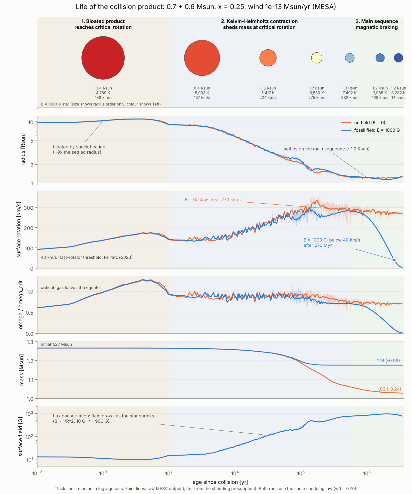
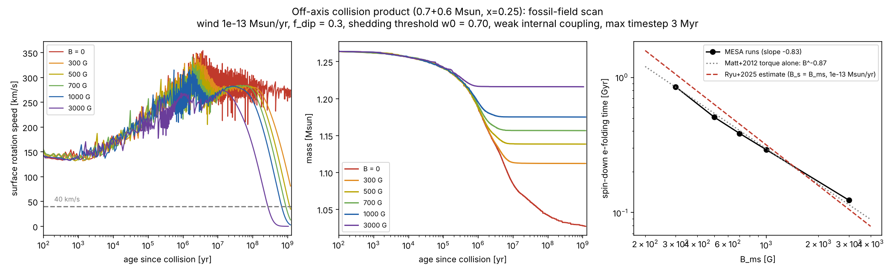
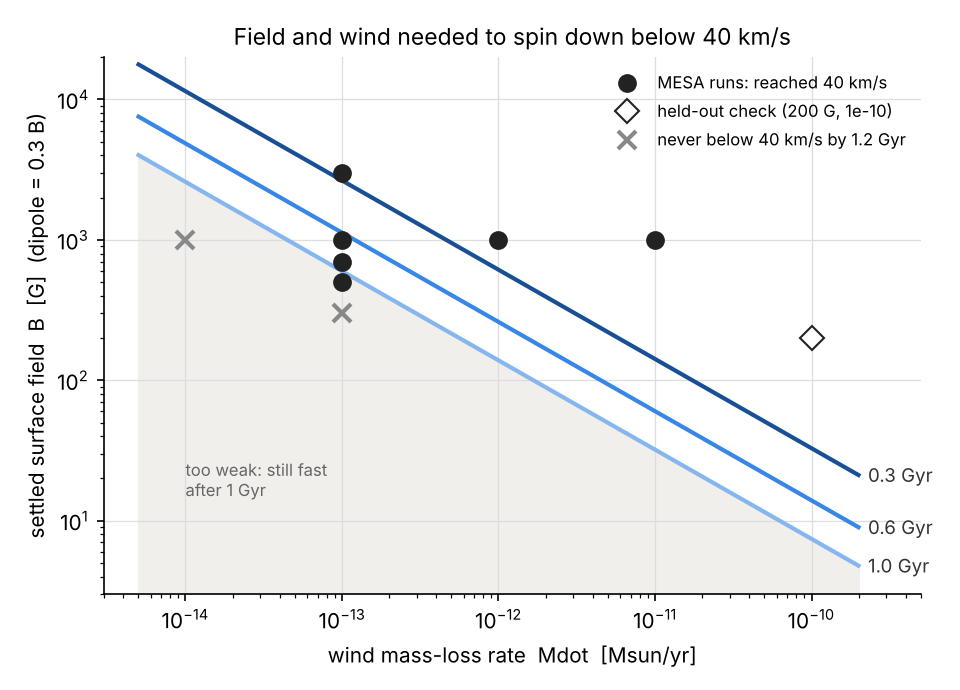
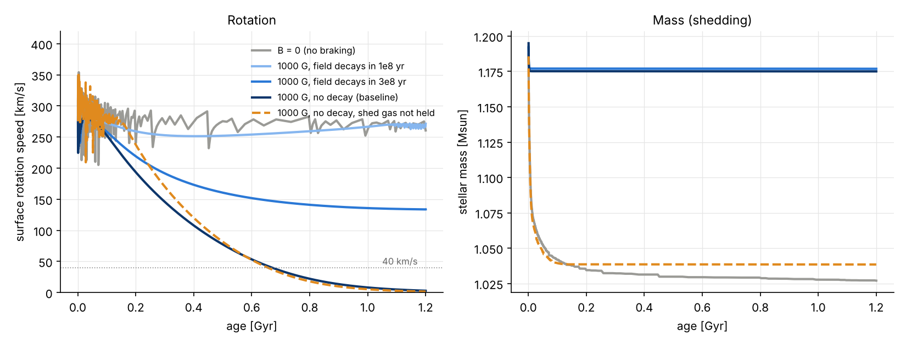

# Magnetic braking of collisional blue stragglers

Can the magnetic field amplified in a stellar collision spin down the product, and on what timescale?

This repository follows one off-axis collision product (0.7 + 0.6 Msun, r_p = 0.25 (R1 + R2), 12 Gyr parents, Z = 0.001) from the collision to the end of the main sequence with MESA, adding fossil-field magnetic braking. It extends the spin-down estimate in Section IV of Ryu et al. (2025), which holds the radius, mass, moment of inertia and field fixed, to a calculation where all of them evolve.



## Background

- Collision products carry too much angular momentum: they reach critical rotation while contracting (Sills et al. 2001), yet most blue stragglers in dense globular clusters rotate slowly (Ferraro et al. 2023).
- Standard magnetic braking needs a convective envelope, which collision products are not expected to have. Sills, Adams & Davies (2005) showed that a magnetically locked disc or wind could remove the excess, but the field was assumed.
- Ryu et al. (2025) showed with MHD simulations that collisions amplify the magnetic field to 10–10^4 G at the surface, estimated a braking time of ~0.1 Gyr (B/100 G)^-1 (Mdot/1e-10 Msun/yr)^-0.5, and left the long-term evolution as future work.

## Pipeline

| Step | Folder | What it does |
|---|---|---|
| 0 | `analytic_model/` | One-zone spin-down model used to scope the problem (Matt et al. 2012 and Justham et al. 2006 torques, disc locking, coupled shedding) |
| 1 | `mesa/1_parents/` | 0.7 and 0.6 Msun parents evolved to 12 Gyr, Z = 0.001 |
| 2 | `collision_product/` | Off-axis collision product from the Lombardi et al. (2002) prescriptions: entropy sorting, shock heating, mass loss, mixing and the specific angular momentum profile j(m) |
| 3 | `mesa/2_relax/` | Relax a MESA model onto the product's composition and entropy profiles |
| 4 | `mesa/3_rotation/` | Impose the j(m) profile |
| 5 | `mesa/4_braking/` | Evolve with fossil-field braking (`src/run_star_extras.f90`) |
| 6 | `analysis/` | Read the MESA histories in `data/runs/` and make the figures |

## Model of the braking

- Surface field from flux conservation: B = B_ms (R_ms / R)^2, with B_ms the field when the star has settled (R_ms = 1.12 Rsun), optionally decaying as exp(-t / t_B).
- Dipole field B_dip = 0.3 B enters the Matt et al. (2012) Alfvén radius; the torque Mdot Omega R^2 [(R_A/R)^2 - 1] is spread over the star.
- Near critical rotation the star sheds mass at Mdot = (M / t_KH) [(w - w0) / (1 - w0)]^3 with w = Omega / Omega_crit and w0 = 0.70. By default the shed gas is held by the field (it enters the torque); `decouple = 1` turns this off.
- Weak internal coupling: hydrodynamic instabilities only, no Spruit–Tayler dynamo.

`x_ctrl` parameters of `run_star_extras.f90`:

| | meaning |
|---|---|
| `x_ctrl(1)` | B_ms [G], 0 = no braking |
| `x_ctrl(2)` | R_ms [Rsun] |
| `x_ctrl(3)` | dipole fraction |
| `x_ctrl(4)` | field decay time t_B [yr], 0 = no decay |
| `x_ctrl(5)` | outer mass fraction the torque acts on, 0 = whole star |
| `x_ctrl(6)` | shedding threshold w0 |
| `x_ctrl(7)` | shedding steepness p |
| `x_ctrl(8)` | shedding cap in units of M / t_KH |
| `x_ctrl(9)` | relaxation time of the shedding rate in units of t_KH (f_lag) |
| `x_ctrl(10)` | 1 = shed gas not held by the field |

## Results

All numbers below are printed by the scripts in `analysis/`.

**1. The product reaches critical rotation while contracting.** It is born bloated (~10 Rsun) by shock heating and stays near critical rotation during Kelvin–Helmholtz contraction, shedding 0.24 Msun without a field and 0.09 Msun with B_ms = 1000 G. This matches Sills et al. (2001) and differs from the binary merger product of Schneider et al. (2020) and the mass gainers of Wang et al. (2026), which spin down relative to critical during thermal relaxation. In this product the whole star is inflated, and its moment of inertia drops by about a factor of 8 during contraction.

**2. If the field survives, the spin-down time is of the same order as the Ryu et al. (2025) estimate.**

| B_ms | shed mass | e-folding time | below 40 km/s |
|---|---|---|---|
| 0 | 0.238 Msun | — | never (stays near 270 km/s) |
| 300 G | 0.153 | 0.85 Gyr | not by 1.2 Gyr |
| 500 G | 0.127 | 0.51 Gyr | 1.15 Gyr |
| 700 G | 0.108 | 0.39 Gyr | 0.89 Gyr |
| 1000 G | 0.090 | 0.29 Gyr | 0.67 Gyr |
| 3000 G | 0.049 | 0.12 Gyr | 0.27 Gyr |

Wind 1e-13 Msun/yr. The e-folding time scales as B^-0.83 and Mdot^-0.56, close to the exponents of the Matt et al. (2012) torque (-0.87, -0.565), so the slopes reflect the adopted torque law rather than an independent result. With B_s = B_ms the Ryu estimate agrees to within 0.8–1.2x over three decades in wind; if B_s is the dipole component instead, the estimate is 1.8–3.6x longer.



**3. The braking constrains one combination of field and wind.** Fitting the time to fall below 40 km/s gives t40 ≈ 0.66 Gyr (B/1000 G)^-0.81 (Mdot/1e-13)^-0.51, which reproduces a held-out run (200 G, 1e-10) to 16%. What is constrained is B · Mdot^0.64. At 1e-13 Msun/yr the product slows below 40 km/s within the main sequence for B_ms ≳ 500 G.



**4. The outcome depends on the field lifetime.** With t_B = 1e8 yr there is essentially no spin-down; with t_B = 3e8 yr the star stalls near 135 km/s. Whether the shed gas is held by the field changes the final mass (1.18 vs 1.04 Msun at 1000 G) but moves t40 by only 2% (1000 G) to 9% (3000 G).



**5. Shedding threshold.** Raising w0 from 0.70 to 0.85 lowers the shed mass by 6–7% and leaves the spin-down time unchanged.

## Limitations

- One collision configuration, built with an approximate prescription; j(m) is placed on a non-rotating structure.
- The field model (flux conservation, fixed dipole fraction 0.3, exponential decay) is a parametrisation, not a field evolution.
- The Matt et al. (2012) fit covers Υ ≤ 2×10^4 and f ≤ 0.4; the baseline here has Υ ≈ 1.6×10^6 and the shedding phase is near f = 1, so the torque law is extrapolated.
- The steady wind of these stars is not constrained by observations; it is scanned from 1e-14 to 1e-10 Msun/yr.
- Shedding is a numerical prescription. In the first ~100 yr the surface exceeds critical rotation because the prescription does not keep up.
- Weak internal coupling only; no disc.
- Ryu et al. (2025) estimate an Ohmic dissipation time comparable to the thermal relaxation time. If the large-scale field decays that fast, braking stops early (result 4). Which field structure survives relaxation is the main open question and needs MHD simulations.

## Reproducing

Python 3.9+ with `numpy` and `matplotlib` (`pip install -r requirements.txt`). Run from the repository root:

```bash
python analysis/summarize_runs.py
python analysis/plot_baseline.py
python analysis/plot_field_scan.py
python analysis/plot_wind_scan.py
python analysis/plot_constraint.py
python analysis/plot_decay.py
python analysis/plot_life.py
python collision_product/offaxis.py
python collision_product/offaxis.py 0.25
python collision_product/plot_product.py
python analytic_model/validate.py
python analytic_model/make_figures.py
python analytic_model/make_figures_disk.py
python analytic_model/make_figures_mesa.py
python analytic_model/run_v04.py
```

`offaxis.py 0.25` rewrites `data/product_x025/`, the input of the MESA relax step (the output is identical to the committed files).

MESA runs used release r26.4.1. For each step, copy `$MESA_DIR/star/work` to a new folder, add the files of that step, then:

1. `mesa/1_parents`: `bash run_parents.sh`, then copy `parent_*.mod` and `profile_*.data` to `data/parents/`.
2. `mesa/2_relax`: copy `data/product_x025/*.dat` into the work folder, `bash run_relax.sh`.
3. `mesa/3_rotation`: in the same folder, `bash run_rot.sh`.
4. `mesa/4_braking`: copy `src/run_star_extras.f90` into `src/`, `./mk`, then `bash run_mb.sh <B_ms> ...`. The command for every run in `data/runs/` is listed in `mesa/4_braking/runs.md`.

## Data

- `data/parents/`: MESA models and profiles of the parents.
- `data/product_x025/`, `data/product_x000/`: relax inputs for the off-axis and head-on products.
- `data/runs/`: gzipped MESA `history.data` for each run (`field_scan`, `wind_scan`, `threshold`, `decay`).
- `data/mesa_track_122.dat`: radius and moment of inertia of the non-rotating head-on product, used by the analytic model v0.4.

## Figures

| | |
|---|---|
| fig3–fig7 | analytic model: torque laws, coupled shedding, B–Mdot map, disc locking |
| fig8 | parents and head-on product (entropy, hydrogen, density) |
| fig9 | MESA contraction track vs the analytic model's assumed contraction |
| fig12 | B = 0 vs B_ms = 1000 G |
| fig13 | field scan |
| fig14 | wind scan |
| fig15 | field–wind constraint |
| fig16 | field decay and decoupled shedding |
| fig17 | evolution of the product in three stages |
| fig18 | HR diagram |

## References

- Ryu, Sills, Pakmor, de Mink & Mathieu 2025, ApJL 980, L38 — [arXiv:2410.00148](https://arxiv.org/abs/2410.00148)
- Wang & Ryu 2024, Blue straggler stars (Encyclopedia of Astrophysics) — [arXiv:2410.10314](https://arxiv.org/abs/2410.10314)
- Lombardi et al. 2002, ApJ 568, 939 — [arXiv:astro-ph/0107388](https://arxiv.org/abs/astro-ph/0107388)
- Sills et al. 2001, ApJ 548, 323 — [arXiv:astro-ph/0008254](https://arxiv.org/abs/astro-ph/0008254)
- Sills, Adams & Davies 2005, MNRAS 358, 716 — [arXiv:astro-ph/0501142](https://arxiv.org/abs/astro-ph/0501142)
- Matt et al. 2012, ApJL 754, L26 — [arXiv:1206.2354](https://arxiv.org/abs/1206.2354)
- Justham, Rappaport & Podsiadlowski 2006, MNRAS 366, 1415 — [arXiv:astro-ph/0511760](https://arxiv.org/abs/astro-ph/0511760)
- Schneider et al. 2020, MNRAS 495, 2796 — [arXiv:2005.05335](https://arxiv.org/abs/2005.05335)
- Wang et al. 2026, A&A 707, A14
- Ferraro et al. 2023, Nature Communications 14, 2584 — [arXiv:2305.08478](https://arxiv.org/abs/2305.08478)
- Heger, Langer & Woosley 2000, ApJ 528, 368 — [arXiv:astro-ph/9904132](https://arxiv.org/abs/astro-ph/9904132)
- Paxton et al. 2011, 2013, 2015, 2018, 2019; Jermyn et al. 2023 (MESA)
